# LAPORAN PERTEMUAN 5

## PRAKTIKUM PEMROGRAMAN BERBASIS WEB

**Disusun Oleh:**  
Davina Arthamevia Azahra  
4524210127

---

# HASIL MODIFIKASI

## 1. Menambahkan Field Nomor Telepon pada Form

Pada program ini saya memodifikasi dengan menambahkan field pada form, sehingga informasi data mahasiswa semakin lengkap.

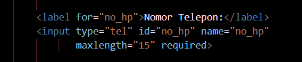

---

## 2. Menambahkan Field Nomor Telepon Pada Data

Selain menambahkan pada form.php saya juga menambahkan pada data.php supaya data yang ditampilkan sesuai dengan yang berada pada form.php.

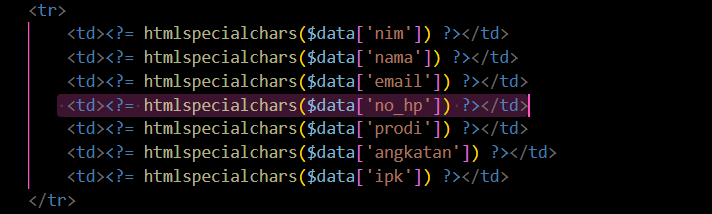

---

## 3. Menambahkan Styling Pada Form dan Data

Pada program ini saya juga membuat modifikasi dengan menambahkan styling pada tampilan form dan data. Dengan adanya styling ini maka tampilan akan menjadi lebih menarik dan mudah dipahami oleh pengguna.

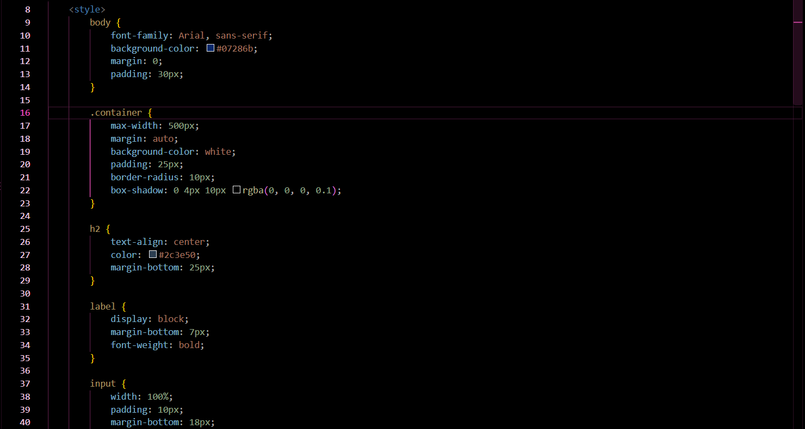

---

# 5 BAGIAN PENTING

## 1. Koneksi PHP

Kode ini penting karena digunakan untuk menghubungkan program PHP dengan database MySQL melalui file koneksi.php. Dengan adanya koneksi ini, program dapat menjalankan query dan mengakses database.

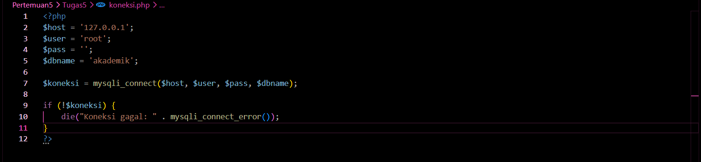
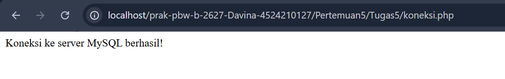

---

## 2. Membuat Form

Kode ini penting karena digunakan untuk membuat form untuk pengisian data mahasiswa sesuai dengan program yang telah dibuat. Disetiap kategori kolom terdapat required yang berfungsi untuk memastikan bahwa kolom tersebut harus diisi.

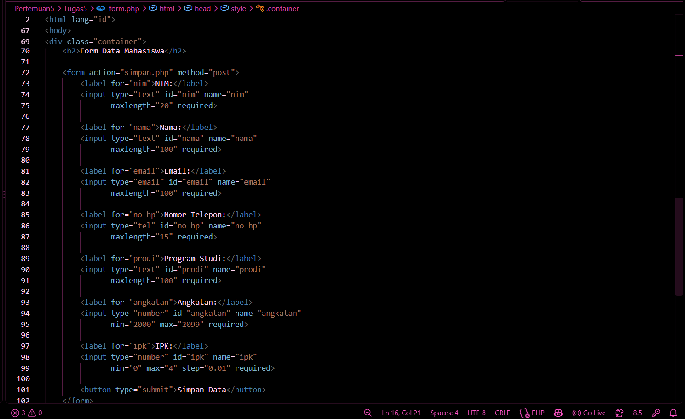

---

## 3. Simpan.php

Kode ini penting karena digunakan untuk menyimpan data dari pengisian formulir. Jadi, simpan.php akan mengambil data dari formulir dan menyimpannya ke dalam variabel PHP sebelum diproses ke database.

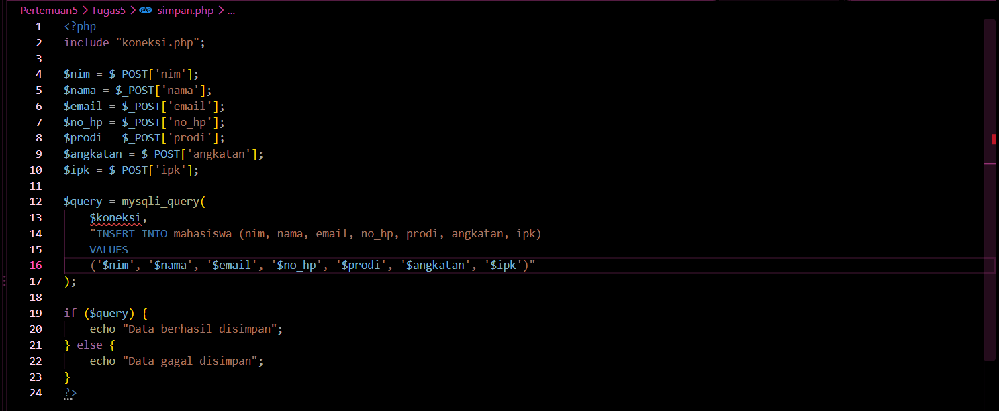
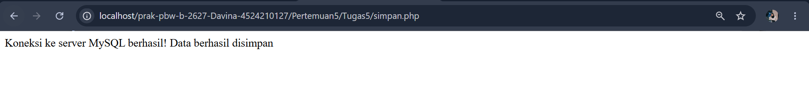

---

## 4. Membuat Data

Kode ini penting karena digunakan untuk menampilkan data dari hasil pengisian form. Jadi, data akan mengambil database melalui koneksi database untuk dapat menampilkan keseluruhan data dari form data mahasiswa.

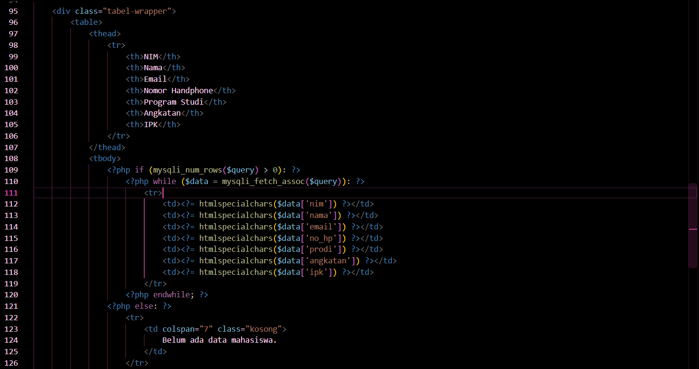

---

## 5. Membuat Styling

Kode ini penting karena digunakan untuk menghasilkan tampilan yang styling pada program yang dibuat.

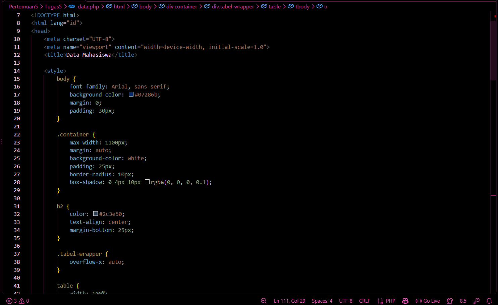

---

# ERROR YANG SEMPAT MUNCUL

Pada saat menjalankan data.php, sempat muncul peringatan Undefined variable $koneksi dan Fatal error pada fungsi mysqli_query(). Error tersebut terjadi karena variabel $koneksi belum terdefinisi sehingga program tidak dapat menggunakan koneksi database untuk menjalankan query SELECT * FROM mahasiswa.

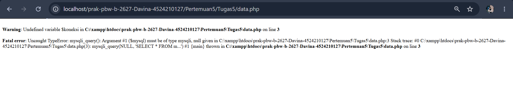

**Perbaikan:**

Memastikan file koneksi.php berada di lokasi yang benar, memanggilnya menggunakan `include "koneksi.php";` sebelum query dijalankan, serta memastikan variabel koneksi yang digunakan adalah `$koneksi` dan sudah terhubung ke database.

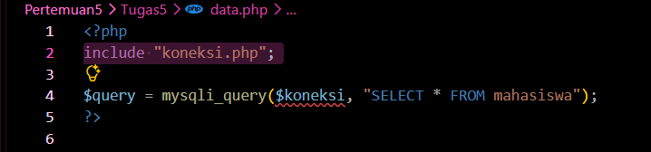

---

# HASIL SEBELUM MODIFIKASI

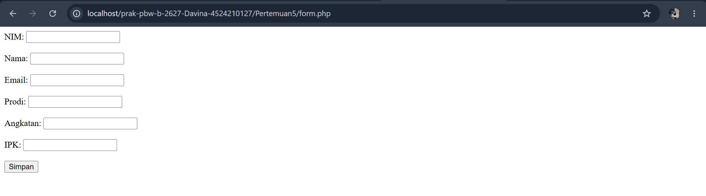
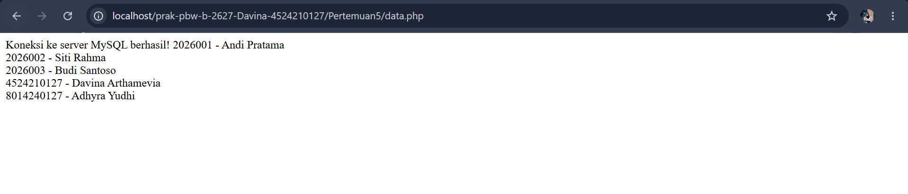

---

# HASIL SESUDAH MODIFIKASI

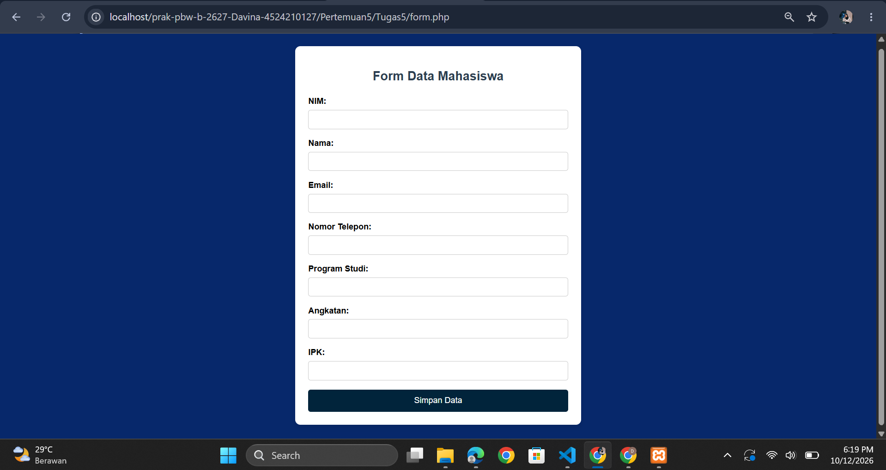
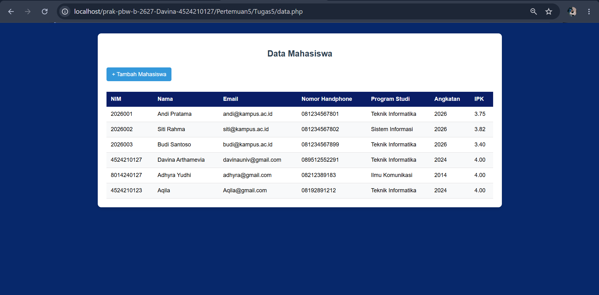