# LAPORAN PERTEMUAN 6
## PRAKTIKUM PEMROGRAMAN BERBASIS WEB

**Disusun Oleh:**  
Davina Arthamevia Azahra  
4524210127

---
# HASIL MODIFIKASI

## 1. Menambahkan Field Nomor Telepon dan Styling pada Formulir

Pada program ini saya memodifikasi formulir dengan menambahkan field nomor telepon dan styling pada tampilan, sehingga informasi data mahasiswa semakin lengkap dan formulir lebih menarik.

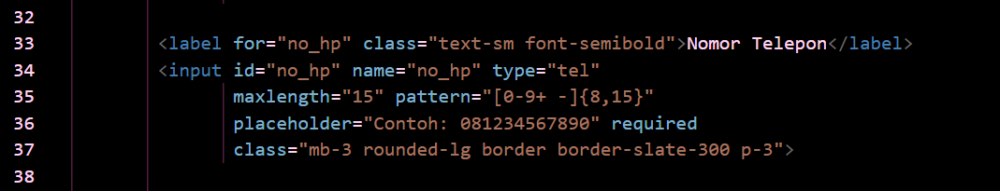

---

## 2. Menambahkan Kolom Pencarian Mahasiswa

Saya menambahkan kolom pencarian data mahasiswa untuk mempermudah pengguna menemukan data yang diperlukan tanpa harus memeriksa seluruh data secara manual.

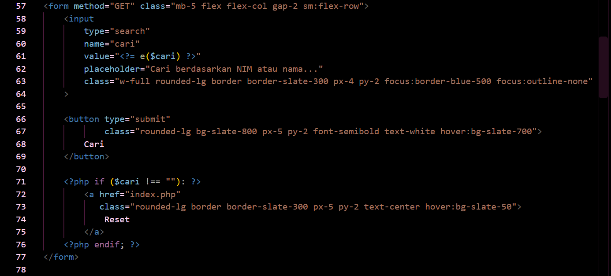

---

## 3. Menambahkan Field Nomor Telepon dan Styling pada Data

Selain menambahkan field nomor telepon pada formulir, saya juga menambahkannya pada tampilan data mahasiswa agar informasi yang ditampilkan sesuai. Tampilan tabel juga dibuat lebih rapi dan mudah dibaca.

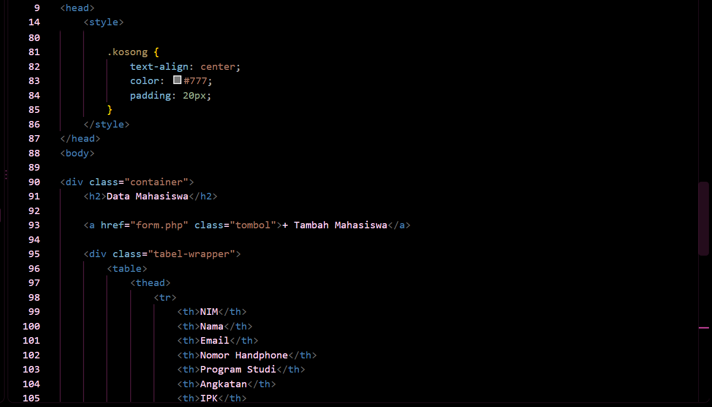

---

## 4. Menambahkan Styling Tampilan

Pada program ini saya menambahkan styling dan beberapa tombol untuk memudahkan pengguna mengakses fitur yang tersedia. Dengan adanya modifikasi ini, tampilan program menjadi lebih menarik dan mudah dipahami.

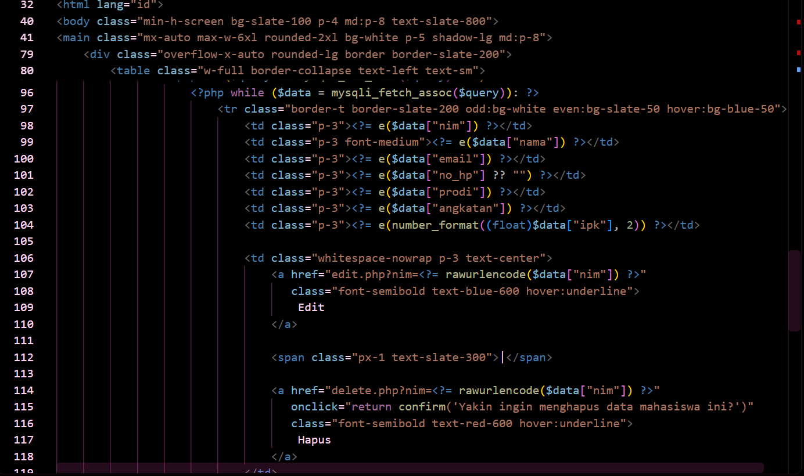

---

# 5 BAGIAN PENTING

## 1. Koneksi PHP

Kode ini penting karena digunakan untuk menghubungkan program PHP dengan database MySQL melalui file koneksi.php. Dengan adanya koneksi ini, program dapat menjalankan query dan mengakses data mahasiswa.

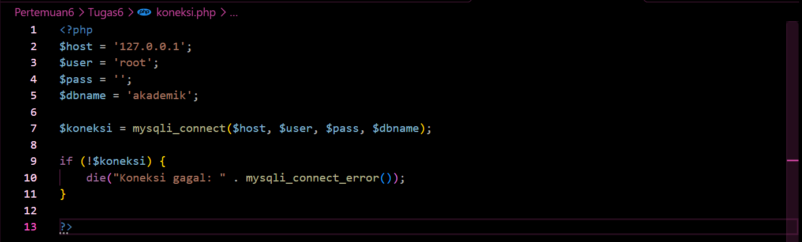

---

## 2. Menampilkan Data Mahasiswa

Kode ini penting karena digunakan untuk mengambil data mahasiswa dari tabel mahasiswa. Perulangan while digunakan untuk memproses setiap baris data agar dapat ditampilkan pada tabel di halaman web.

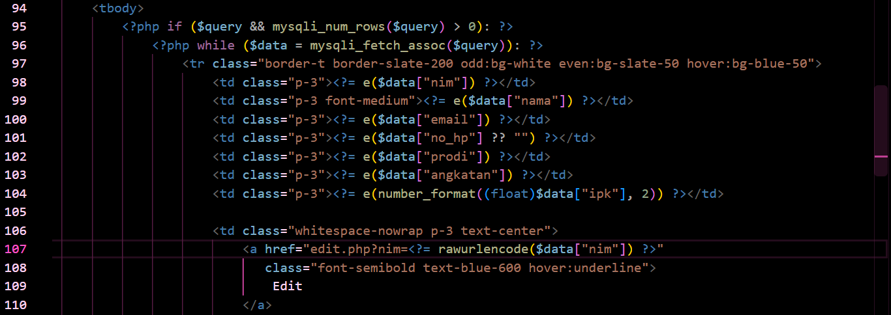

---

## 3. Menambahkan Data Mahasiswa

Kode ini penting karena digunakan untuk menambahkan data mahasiswa baru ke database. Perintah INSERT INTO menentukan tabel dan kolom tujuan, sedangkan prepared statement membantu memproses input dengan lebih aman.

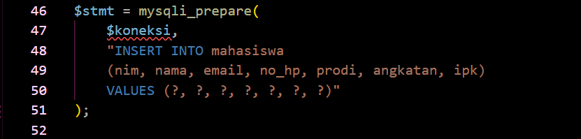

---

## 4. Mengedit Data Mahasiswa

Kode ini penting karena digunakan untuk memperbarui data mahasiswa yang sudah tersimpan. Kondisi WHERE nim = ? menentukan data mahasiswa yang akan diubah berdasarkan NIM.

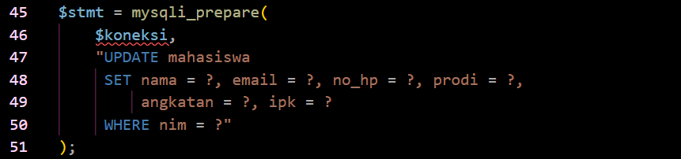

---

## 5. Menghapus Data Mahasiswa

Kode ini penting karena digunakan untuk menghapus data mahasiswa berdasarkan NIM. Dengan demikian, data yang dihapus adalah data mahasiswa yang sesuai dengan NIM yang dipilih.

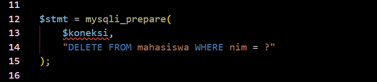

---

# ERROR YANG SEMPAT MUNCUL

Pada saat menjalankan file edit.php, muncul peringatan Undefined array key "nim" pada baris ke-4 dan Trying to access array offset on value of type null pada baris ke-26. Error tersebut terjadi karena halaman edit.php dibuka tanpa menyertakan parameter NIM pada URL, sehingga program tidak dapat mengetahui data mahasiswa yang ingin diubah. Akibatnya, data mahasiswa tidak ditemukan dan variabel $data bernilai null, tetapi tetap digunakan untuk menampilkan informasi pada formulir.

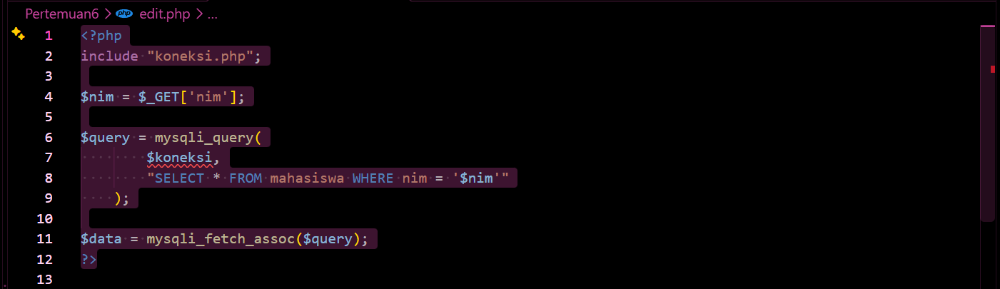
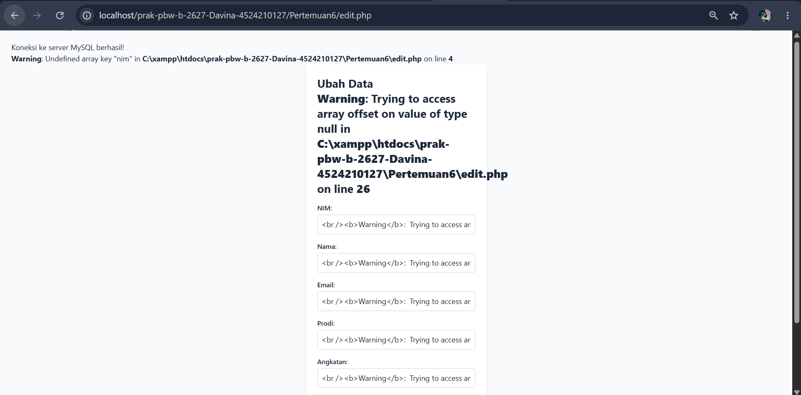

## Perbaikan:
Perbaikan dilakukan dengan menambahkan pengecekan parameter NIM sebelum proses pengambilan data dijalankan. Selain itu, query database diperbaiki menggunakan prepared statement dan ditambahkan pengecekan untuk memastikan data mahasiswa ditemukan. Halaman edit.php kemudian dijalankan melalui tombol Edit pada halaman utama (index.php) agar parameter NIM terkirim melalui URL dengan benar.

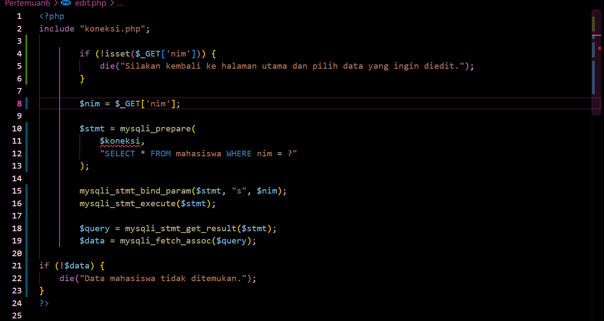

---

# HASIL SEBELUM MODIFIKASI

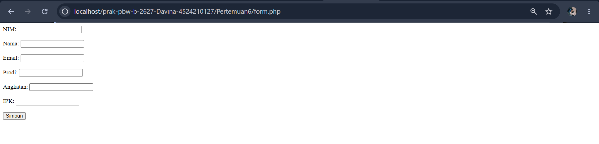
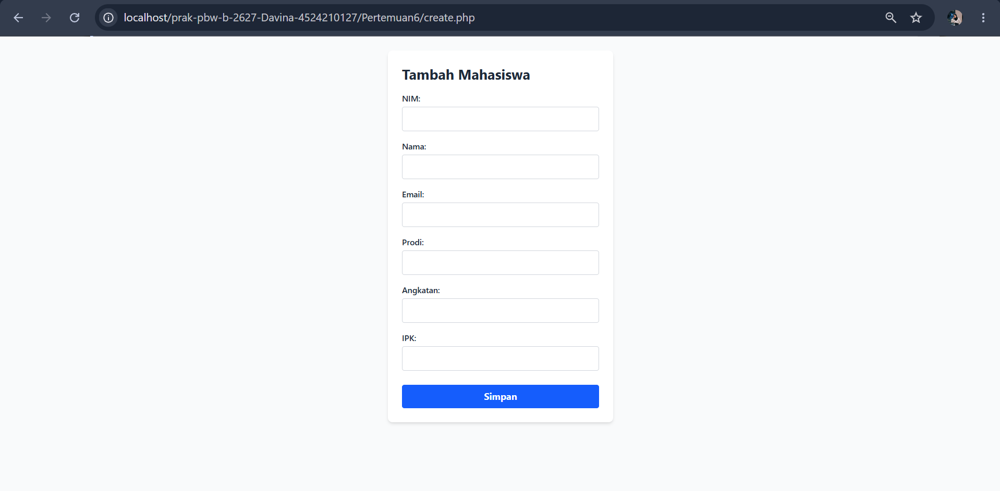
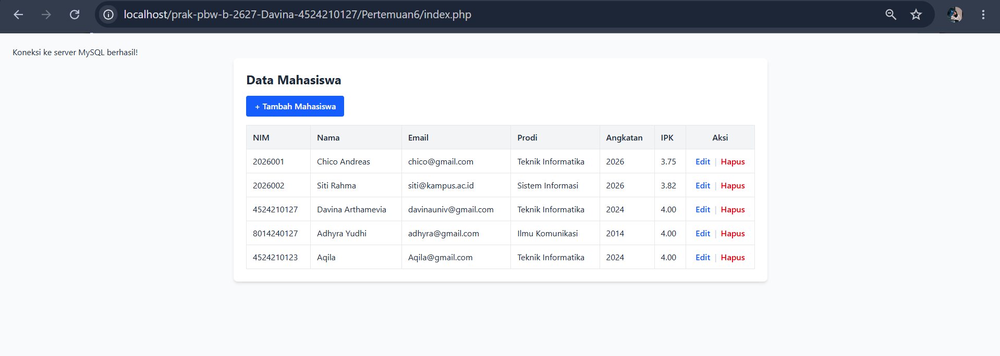

---

# HASIL SESUDAH MODIFIKASI

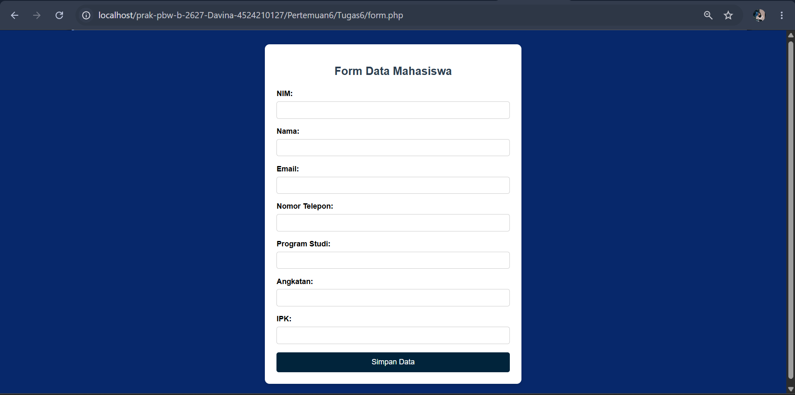
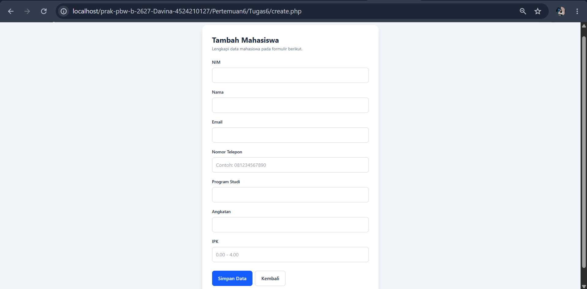
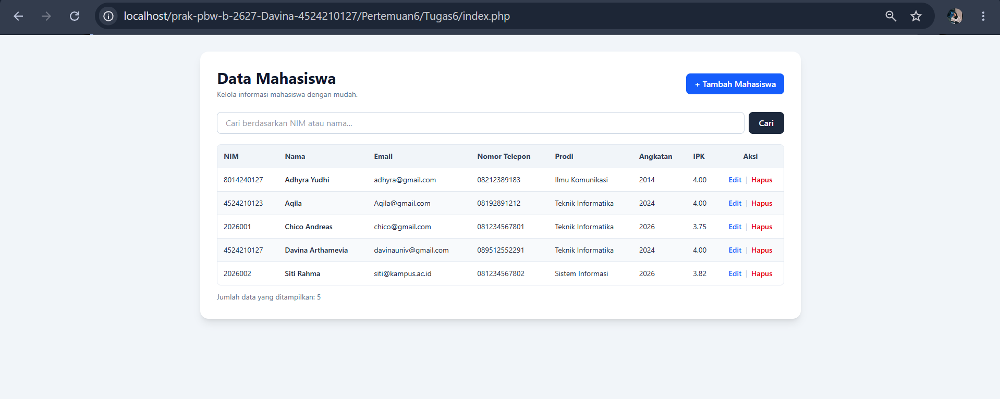
