# LAPORAN PERTEMUAN 7
## PRAKTIKUM PEMROGRAMAN BERBASIS WEB

**Disusun Oleh:**  
Davina Arthamevia Azahra  
4524210127

---

# HASIL PROGRAM

## 1. Membuat Database MySQL

Pada tugas ini, saya membuat database penjualan_produk menggunakan phpMyAdmin untuk menyimpan data produk. Tabel produk memiliki beberapa field, yaitu id_produk, nama_produk, harga, dan stok. Database ini digunakan agar data produk yang ditambahkan melalui program dapat disimpan dan ditampilkan kembali.

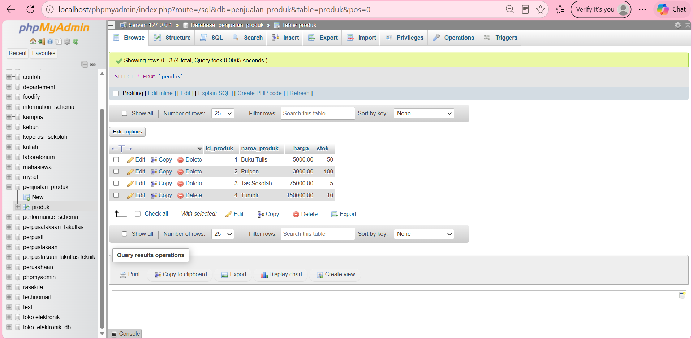

---

## 2. Menampilkan Daftar Produk

Pada bagian ini, saya membuat halaman daftar produk menggunakan file Views/produk/index.php. Halaman tersebut menampilkan data produk yang diambil dari database, meliputi nama produk, harga, dan stok. Selain itu, terdapat tombol Tambah Produk untuk menambahkan data baru dan tombol Edit untuk mengubah data produk yang sudah tersimpan.

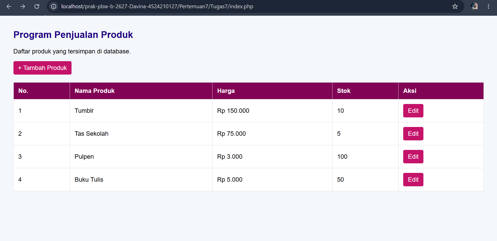

---

## 3. Menambahkan Data Produk

Saya membuat halaman tambah produk menggunakan file Views/produk/create.php. Pada halaman ini, pengguna dapat memasukkan nama produk, harga, dan stok melalui formulir. Setelah tombol Simpan Produk ditekan, data akan dikirim menggunakan metode POST untuk diproses oleh Controller dan disimpan ke database melalui Model.

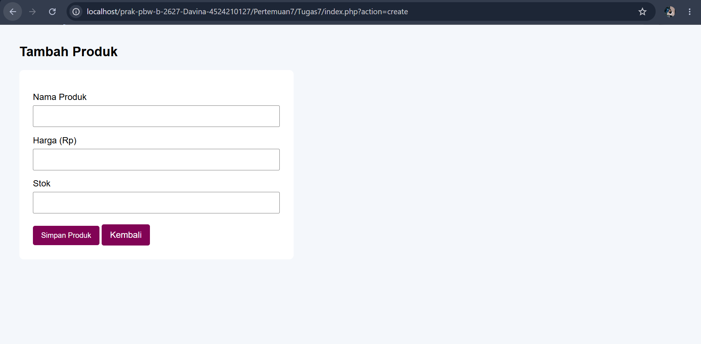

---

## 4. Mengedit Data Produk

Saya membuat halaman edit produk menggunakan file Views/produk/edit.php. Halaman ini menampilkan data produk yang telah dipilih berdasarkan ID produk. Pengguna dapat mengubah nama produk, harga, atau stok, kemudian menekan tombol Simpan Perubahan agar data terbaru disimpan ke database.

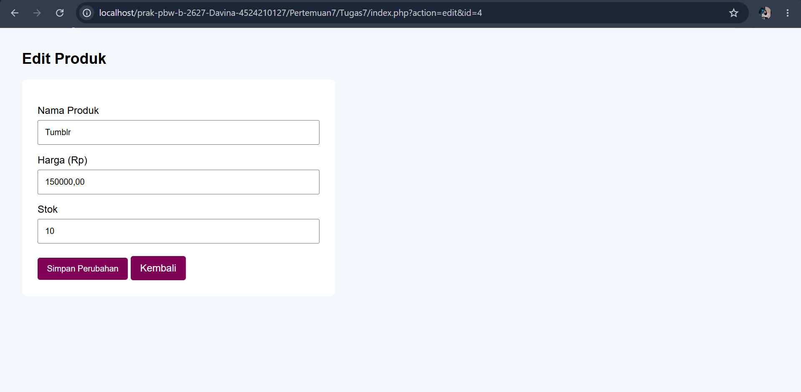

---

## 5. Hasil Perubahan Data Produk

Setelah proses penambahan atau pengeditan berhasil dilakukan, program akan kembali ke halaman daftar produk. Data yang ditampilkan merupakan data terbaru dari database MySQL. Dengan demikian, program dapat digunakan untuk mengelola data produk secara sederhana.

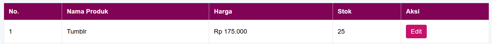

---

# BAGIAN PENTING DALAM KODE PROGRAM

## 1. Koneksi PHP dengan Database MySQL

Kode koneksi terdapat pada file koneksi.php. Bagian ini berfungsi menghubungkan program PHP dengan database penjualan_produk menggunakan fungsi mysqli_connect(). Jika koneksi berhasil, program dapat menjalankan query untuk mengambil dan mengubah data produk.

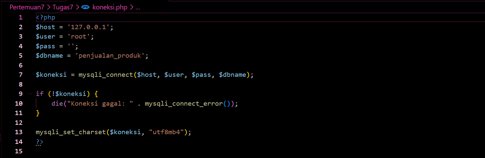

Fungsi mysqli_connect() digunakan untuk membuat koneksi ke database, sedangkan kondisi if (!$koneksi) digunakan untuk memeriksa apakah koneksi gagal.

---

## 2. Mengambil Data Produk Menggunakan Model

Kode ini terdapat pada file models/ProdukModel.php, tepatnya pada fungsi getAllProduk(). Fungsi tersebut digunakan untuk mengambil seluruh data produk dari tabel produk. Hasil query kemudian dikembalikan agar dapat diproses oleh Controller dan ditampilkan pada halaman daftar produk.

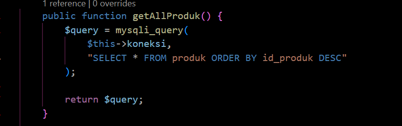

Perintah SELECT * FROM produk digunakan untuk mengambil data dari tabel produk, sedangkan ORDER BY id_produk DESC mengurutkan data berdasarkan ID dari yang terbesar ke yang terkecil.

---

## 3. Menambahkan Data Produk ke Database

Kode ini terdapat pada file models/ProdukModel.php, tepatnya pada fungsi tambahProduk(). Fungsi tersebut digunakan untuk menyimpan produk baru ke dalam tabel produk.

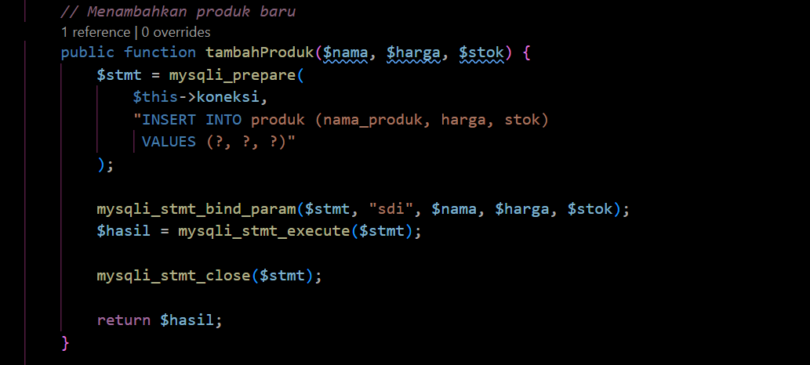

Perintah INSERT INTO digunakan untuk menambahkan data baru. Fungsi mysqli_prepare() menyiapkan query, sedangkan mysqli_stmt_bind_param() menghubungkan nilai variabel dengan parameter query. Tipe sdi menunjukkan bahwa nama produk bertipe string, harga bertipe double, dan stok bertipe integer.

---

## 4. Mengedit Data Produk

Kode pengeditan terdapat pada file models/ProdukModel.php, tepatnya pada fungsi updateProduk(). Fungsi ini digunakan untuk memperbarui nama produk, harga, dan stok berdasarkan ID produk yang dipilih.

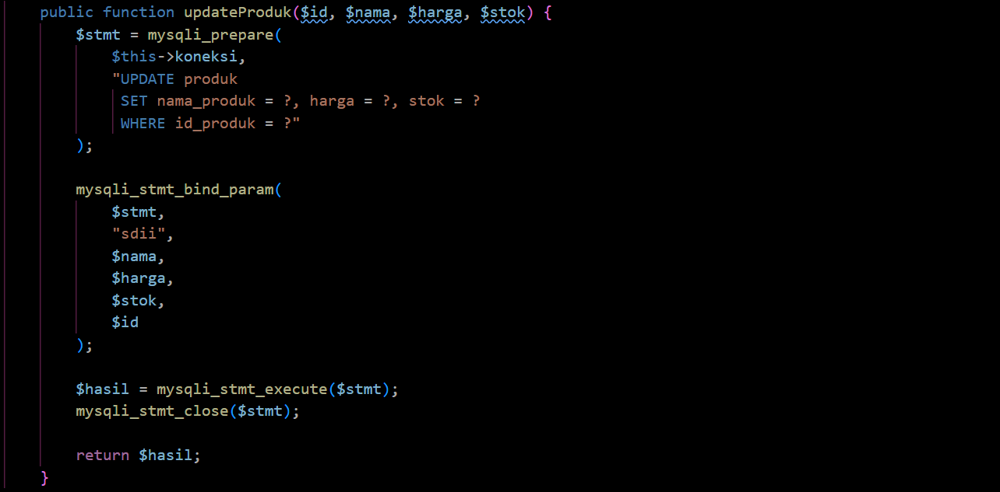

Perintah UPDATE digunakan untuk mengubah data yang sudah tersimpan. Kondisi WHERE id_produk = ? memastikan bahwa perubahan dilakukan pada produk dengan ID yang sesuai, bukan pada seluruh data produk.

---

## 5. Menampilkan Data Produk dengan Perulangan While

Kode ini terdapat pada file Views/produk/index.php. Perulangan while digunakan untuk membaca hasil query satu per satu sampai seluruh data produk berhasil ditampilkan pada tabel.

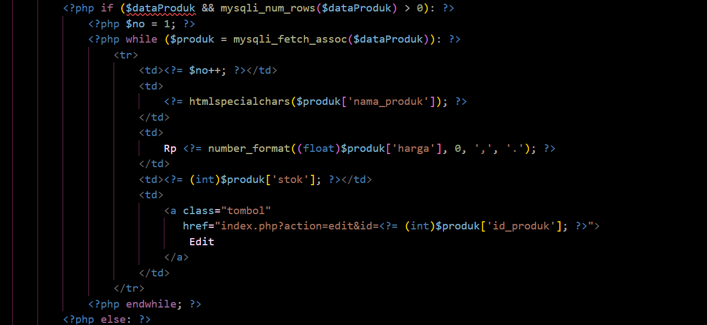

Fungsi mysqli_fetch_assoc() mengambil setiap baris data dalam bentuk array asosiatif. Perulangan berhenti ketika tidak ada lagi baris yang dapat diambil. Fungsi htmlspecialchars() digunakan untuk membantu mencegah teks dari database ditampilkan sebagai kode HTML.

---

## 6. Controller untuk Menghubungkan Model dan View

Kode ini terdapat pada file controllers/ProdukController.php. Controller bertugas mengatur alur program, menerima permintaan pengguna, memanggil fungsi Model, dan menentukan View yang akan ditampilkan.

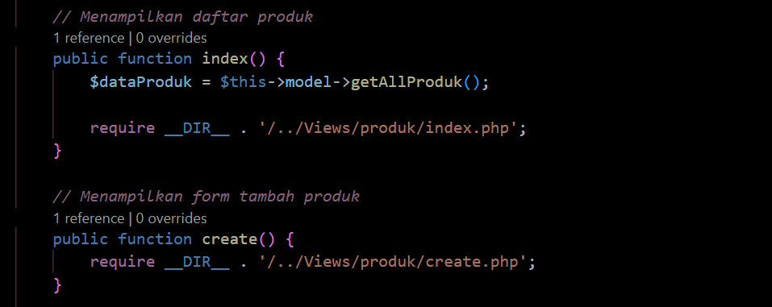

Fungsi index() mengambil data produk melalui Model sebelum menampilkan halaman daftar produk. Sementara itu, fungsi create() menampilkan halaman formulir tambah produk.

---

## 7. File Utama untuk Mengatur Alur Program

Kode ini terdapat pada file utama index.php. File ini menjadi pintu masuk program, memanggil koneksi database dan Controller, serta menentukan proses berdasarkan parameter action pada URL.

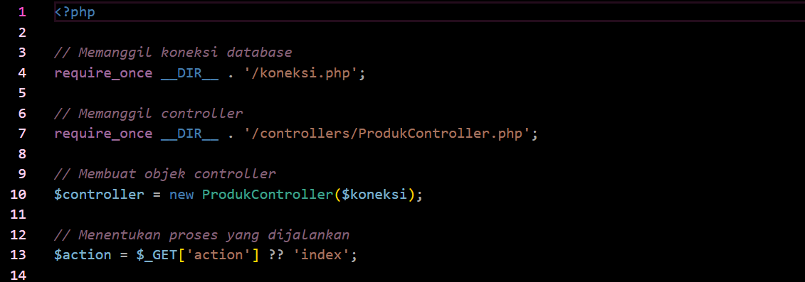

Variabel $action digunakan untuk menentukan proses yang diminta pengguna. Struktur switch mengarahkan permintaan ke fungsi Controller yang sesuai, seperti menampilkan daftar, menambah, atau mengedit produk.
