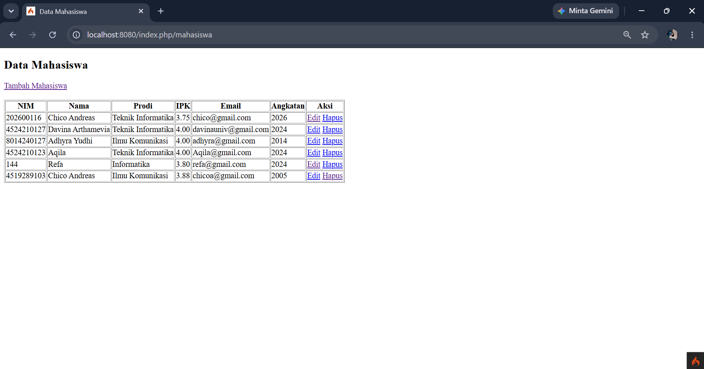
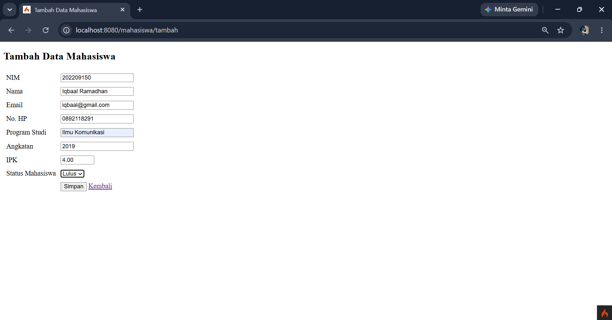
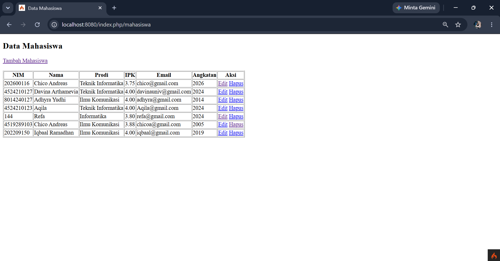
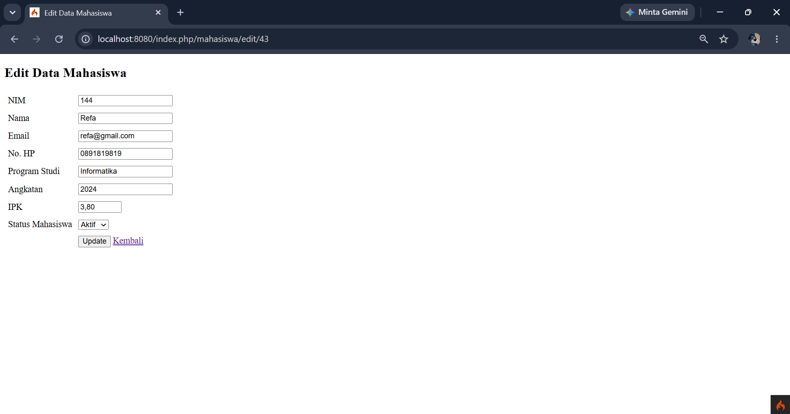
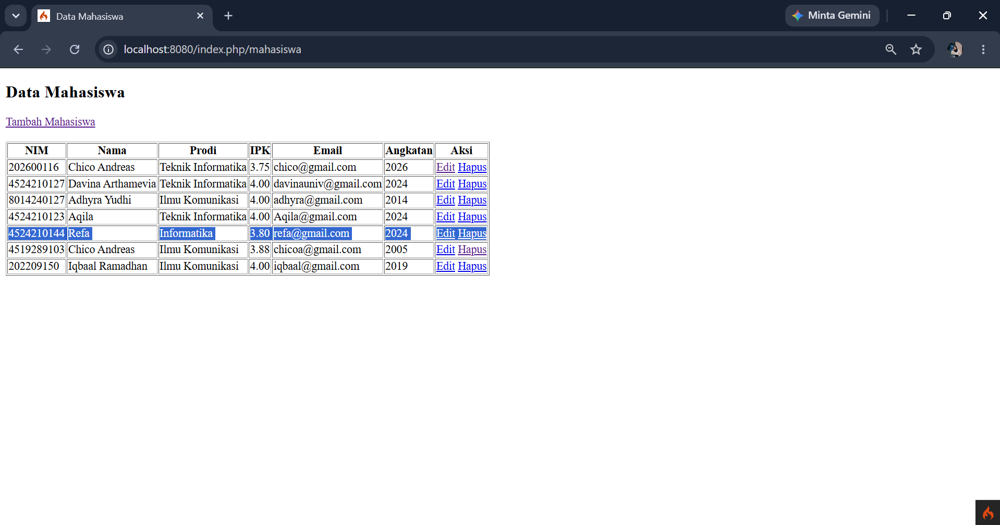
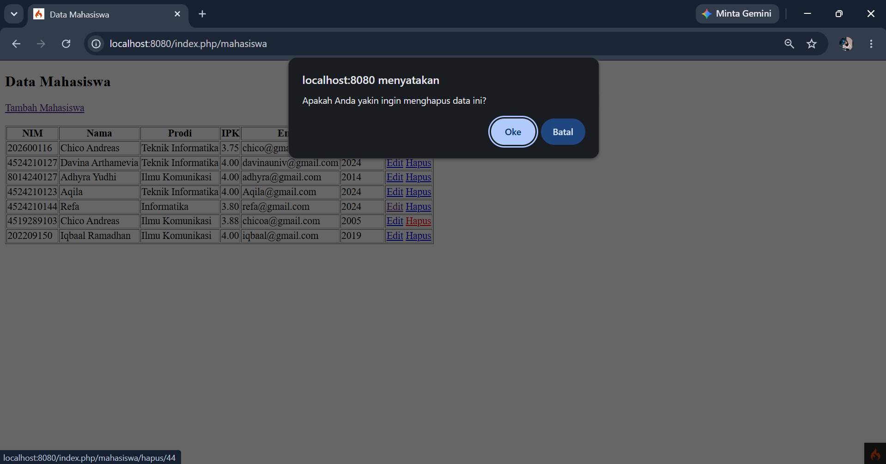
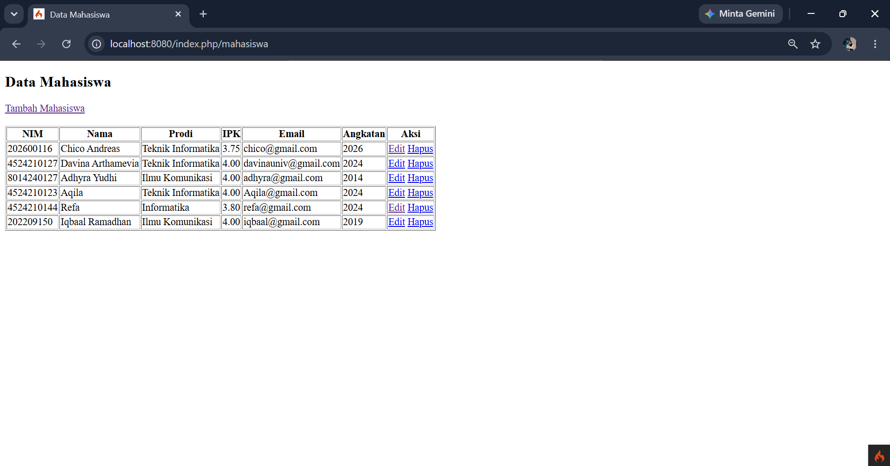
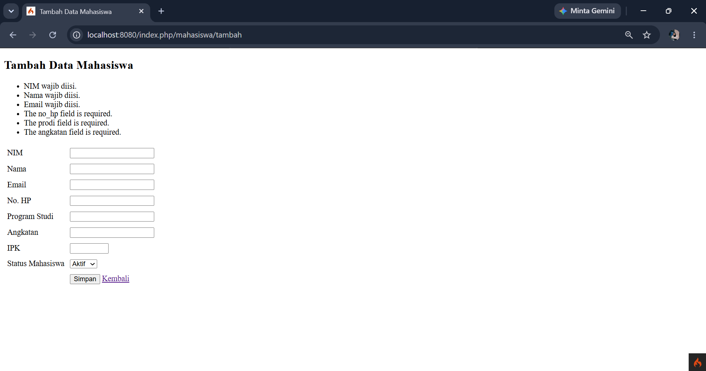
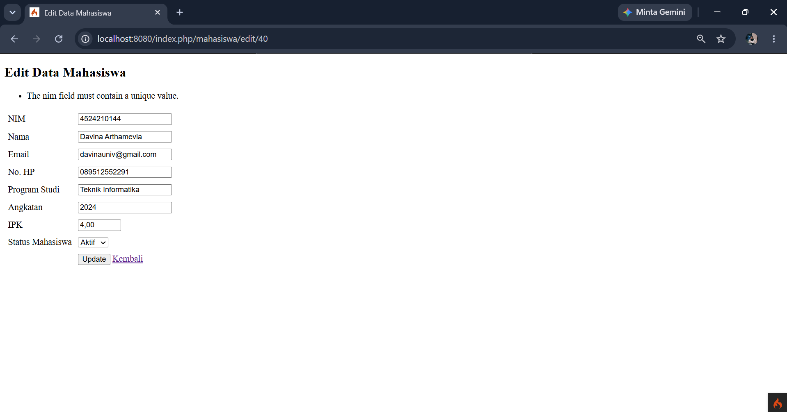

# TUGAS 8 – MODUL CRUD DATA MAHASISWA MENGGUNAKAN CODEIGNITER 4

### Penjelasan Struktur Folder

| File/Folder | Fungsi |
|---|---|
| `Config/Routes.php` | Mengatur URL dan menghubungkannya dengan fungsi pada Controller. |
| `Controllers/MahasiswaController.php` | Mengatur proses menampilkan, menambahkan, mengubah, dan menghapus data mahasiswa. |
| `Models/MahasiswaModel.php` | Menghubungkan aplikasi dengan tabel mahasiswa dan mengelola data pada database. |
| `Views/mahasiswa/index.php` | Menampilkan daftar data mahasiswa. |
| `Views/mahasiswa/create.php` | Menampilkan formulir tambah mahasiswa. |
| `Views/mahasiswa/edit.php` | Menampilkan formulir edit mahasiswa. |
| `.env` | Mengatur konfigurasi aplikasi, termasuk koneksi database. |

## 1. Implementasi Program

### 1.1 Konfigurasi Database

Aplikasi dihubungkan dengan database MySQL yang telah tersedia, yaitu database `akademik` dengan tabel `mahasiswa`.

Tabel mahasiswa memiliki beberapa kolom, yaitu:

- `id`
- `nim`
- `nama`
- `email`
- `no_hp`
- `prodi`
- `angkatan`
- `ipk`
- `status_mahasiswa`

Kolom tersebut digunakan untuk menyimpan informasi mahasiswa yang dikelola melalui aplikasi.

### 1.2 Pembuatan Model

Model dibuat pada file `MahasiswaModel.php`. Model berfungsi untuk menghubungkan aplikasi dengan tabel mahasiswa pada database.

 bagian ini digunakan untuk menentukan nama tabel, primary key, penggunaan auto increment, tipe data hasil pengambilan, serta daftar field yang diperbolehkan untuk proses penyimpanan dan perubahan data.

### 1.3 Pembuatan Controller

Controller dibuat pada file `MahasiswaController.php`. Controller berfungsi sebagai pengatur alur proses antara Model dan View.

Beberapa fungsi yang diterapkan antara lain:

- `index()` untuk mengambil dan menampilkan seluruh data mahasiswa.
- `create()` untuk menampilkan halaman formulir tambah mahasiswa.
- `store()` untuk memproses penyimpanan data mahasiswa baru.
- `edit($id)` untuk mengambil data mahasiswa berdasarkan ID.
- `update($id)` untuk memproses perubahan data mahasiswa.
- `delete($id)` untuk menghapus data mahasiswa berdasarkan ID.

### 1.4 Pengaturan Routes

Routes digunakan untuk menentukan alamat URL yang dapat diakses pengguna dan menghubungkannya dengan fungsi pada Controller.

| Method | URL | Fungsi |
|---|---|---|
| GET | `/mahasiswa` | Menampilkan daftar mahasiswa |
| GET | `/mahasiswa/tambah` | Menampilkan formulir tambah mahasiswa |
| POST | `/mahasiswa/simpan` | Menyimpan data mahasiswa |
| GET | `/mahasiswa/edit/(:num)` | Menampilkan formulir edit mahasiswa |
| POST | `/mahasiswa/update/(:num)` | Memperbarui data mahasiswa |
| POST | `/mahasiswa/hapus/(:num)` | Menghapus data mahasiswa |

### 1.5 Pembuatan View

View digunakan untuk menampilkan halaman yang berinteraksi langsung dengan pengguna. Pada tugas ini terdapat tiga halaman utama:

1. **Index:** Menampilkan seluruh data mahasiswa dalam bentuk tabel beserta pilihan untuk menambah, mengedit, dan menghapus data.
2. **Create:** Menampilkan formulir untuk memasukkan data mahasiswa baru.
3. **Edit:** Menampilkan formulir yang telah terisi dengan data sebelumnya sehingga pengguna dapat melakukan perubahan.

## 2. Fitur yang Diimplementasikan

### 2.1 Read (Menampilkan Data)

Fitur Read digunakan untuk mengambil seluruh data mahasiswa dari database dan menampilkannya pada halaman utama. Data yang ditampilkan meliputi NIM, nama, email, nomor HP, program studi, angkatan, IPK, dan status mahasiswa.

### 2.2 Create (Menambahkan Data)

Fitur Create digunakan untuk menambahkan data mahasiswa baru melalui formulir yang telah disediakan. Setelah formulir diisi dan dikirim, Controller akan memeriksa data yang dimasukkan. Jika data memenuhi ketentuan, data akan disimpan ke dalam database.

### 2.3 Update (Mengubah Data)

Fitur Update digunakan untuk mengubah informasi mahasiswa yang sudah tersimpan. Pengguna dapat memilih tombol Edit pada data yang ingin diubah. Selanjutnya, aplikasi menampilkan formulir yang telah terisi dengan data sebelumnya.

Setelah perubahan dikirim, sistem akan memproses dan memperbarui data mahasiswa berdasarkan ID yang dipilih.

### 2.4 Delete (Menghapus Data)

Fitur Delete digunakan untuk menghapus data mahasiswa dari database. Pengguna dapat memilih tombol Hapus pada data yang ingin dihilangkan. Sebelum proses penghapusan dilakukan, sistem menampilkan konfirmasi agar pengguna dapat memastikan kembali tindakan tersebut.

## 3. Validasi Data

Validasi diterapkan untuk mengurangi kesalahan input dan menjaga konsistensi data mahasiswa.

| Field | Ketentuan |
|---|---|
| NIM | Wajib diisi, minimal 5 karakter, maksimal 15 karakter, dan tidak boleh duplikat. |
| Nama | Wajib diisi, minimal 3 karakter, maksimal 100 karakter. |
| Email | Wajib diisi, format email harus benar, dan tidak boleh duplikat. |
| No. HP | Wajib diisi dan maksimal 15 karakter. |
| Program Studi | Wajib diisi dan maksimal 80 karakter. |
| Angkatan | Wajib diisi dengan 4 digit angka. |
| IPK | Boleh kosong, tetapi jika diisi harus berupa angka desimal dengan rentang 0 sampai 4. |
| Status Mahasiswa | Wajib dipilih dari Aktif, Cuti, atau Lulus. |

Apabila data tidak memenuhi ketentuan, sistem akan menampilkan pesan kesalahan dan mengembalikan pengguna ke formulir sebelumnya. Data yang telah dimasukkan juga dipertahankan agar pengguna tidak perlu mengisi ulang seluruh formulir.

## 4. Dokumentasi Hasil Implementasi

### 4.1 Halaman Daftar Mahasiswa

Halaman ini menampilkan seluruh data mahasiswa yang tersimpan di dalam database. Pada halaman ini tersedia fitur untuk menambahkan, mengubah, dan menghapus data.

### 4.2 Halaman Tambah Mahasiswa

Halaman tambah mahasiswa digunakan untuk memasukkan data mahasiswa baru melalui formulir yang telah disediakan.

### 4.3 Hasil Penambahan Data

Setelah formulir diisi dengan benar, data mahasiswa berhasil disimpan dan ditampilkan pada halaman daftar mahasiswa.

### 4.4 Halaman Edit Mahasiswa

Halaman edit digunakan untuk mengubah informasi mahasiswa yang sudah tersimpan di database.

### 4.5 Hasil Perubahan Data

Setelah perubahan disimpan, sistem akan memperbarui informasi mahasiswa sesuai dengan data yang dimasukkan.

### 4.6 Proses Penghapusan Data

Sebelum data dihapus, sistem menampilkan konfirmasi untuk memastikan bahwa pengguna benar-benar ingin menghapus data mahasiswa tersebut.

### 4.7 Validasi Data

Validasi digunakan untuk memeriksa data yang dimasukkan pengguna. Apabila terdapat data yang tidak sesuai ketentuan, sistem akan menampilkan pesan kesalahan.

Tampilan apabila pengguna belum mengisi kolom formulir

Tampilan apabila ternyata data sudah digunakan